# TP FPGA — Compte rendu global

**Binôme :** Maxime Zaragoza — Sidibé Francis Junior
**Formation :** ENSEA, 2A — 2026/2027
**Carte :** Terasic DE10-Nano (Cyclone V `5CSEBA6U23I7`) + carte mezzanine TELECRAN
**Outils :** Quartus Prime Lite 24.1, ModelSim / Questa

L'énoncé est dans [`3-tp/fpga_tp.md`](3-tp/fpga_tp.md).

## Sommaire

- [Organisation du dépôt](#organisation-du-dépôt)
- [Séance 1 (29/09/2026) — TP1 : Tutoriel Quartus](#séance-1-29092026--tp1--tutoriel-quartus)
- [Séance 2 (19/10/2026) — Projet Écran magique : encodeurs](#séance-2-19102026--projet-écran-magique--encodeurs)
- [Séance 3 (03/11/2026) — Projet Écran magique : contrôleur HDMI, déplacement d'un pixel et mémorisation](#séance-3-03112026--projet-écran-magique--contrôleur-hdmi-déplacement-dun-pixel-et-mémorisation)
  - [Partie 1 — Contrôleur HDMI](#partie-1--contrôleur-hdmi)
  - [Partie 2 — Déplacement d'un pixel](#partie-2--déplacement-dun-pixel)
  - [Partie 3 — Mémorisation](#partie-3--mémorisation)
- [Séance 4 — Projet Écran magique : effacement](#séance-4--projet-écran-magique--effacement)
- [Suivi des questions de l'énoncé](#suivi-des-questions-de-lénoncé)
- [Annexe : simuler et tester](#annexe--simuler-et-tester)

## Organisation du dépôt

```
3-tp/
├── fpga_tp.md                     énoncé
├── TP1-Tuto_Quartus/              séance 1
│   ├── tuto_fpga.vhd              bouton -> LED
│   ├── led_blink.vhd              LED clignotante (avec diviseur)
│   ├── led_blink_chenillard.vhd   chenillard 10 LED
│   ├── img/                       captures et photos de la séance
│   └── Projet quartus/            projets Quartus
├── TP2-Projet_ecran/              projet Écran magique (simulations)
│   ├── Encoder/                   encodeur : VHDL, testbench, .do, captures
│   ├── HDMI/                      contrôleur HDMI : testbench, .do, captures
│   ├── Deplacement_pixel/         déplacement d'un pixel : top telecran.vhd, schéma, vidéo
│   └── Memorisation/              mémorisation : top telecran.vhd avec framebuffer, testbench
└── telecran/telecran/             projet Quartus du télécran (top : telecran.vhd)
```

---

## Séance 1 (29/09/2026) — TP1 : Tutoriel Quartus

### Premier projet : un bouton allume une LED

Code : [`tuto_fpga.vhd`](3-tp/TP1-Tuto_Quartus/tuto_fpga.vhd)

Le projet `tuto_fpga` a été créé pour le FPGA `5CSEBA6U23I7`. Les broches assignées sont `PIN_AH27` pour `pushl` (bouton de l'encodeur gauche) et `PIN_AG28` pour `led0`. La synthèse passe sans erreur, avec un seul warning (sur le nombre de processeurs, sans importance) :


La carte a été programmée par le port USB BLASTER II avec l'outil Programmer (chaîne JTAG : `SOCVHPS` puis `5CSEBA6U23`) :

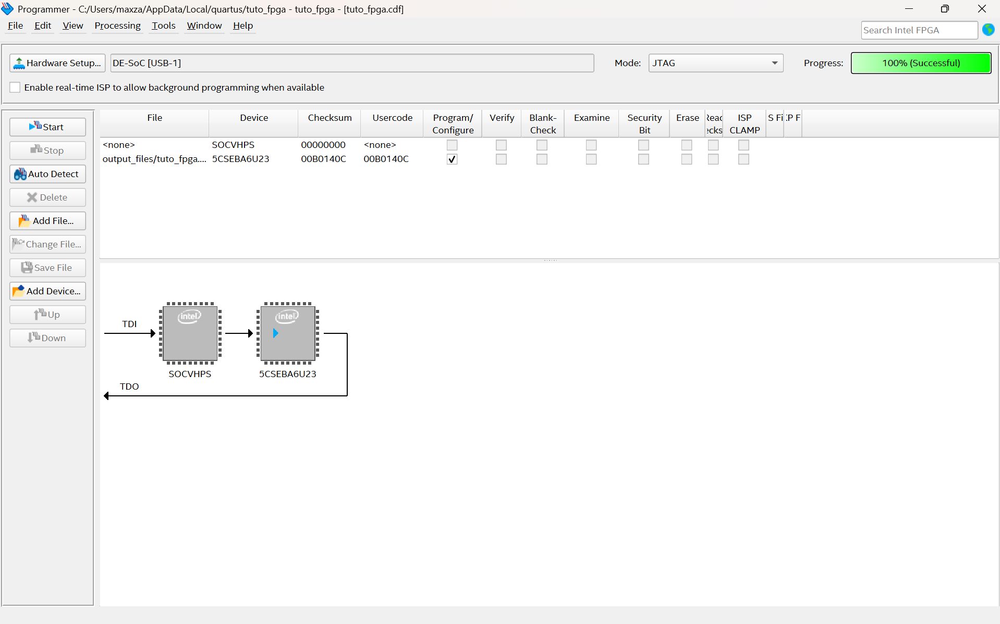

**Observation :** avec `led0 <= pushl;`, le comportement est inversé. La LED est allumée au repos et s'éteint quand on appuie. Le bouton est câblé avec une résistance de pull-up : il vaut `'1'` au repos et `'0'` quand il est enfoncé.

**Correction :** `led0 <= not pushl;`. La LED est maintenant éteinte au repos et s'allume à l'appui :

| Bouton relâché | Bouton enfoncé |
|:---:|:---:|
| 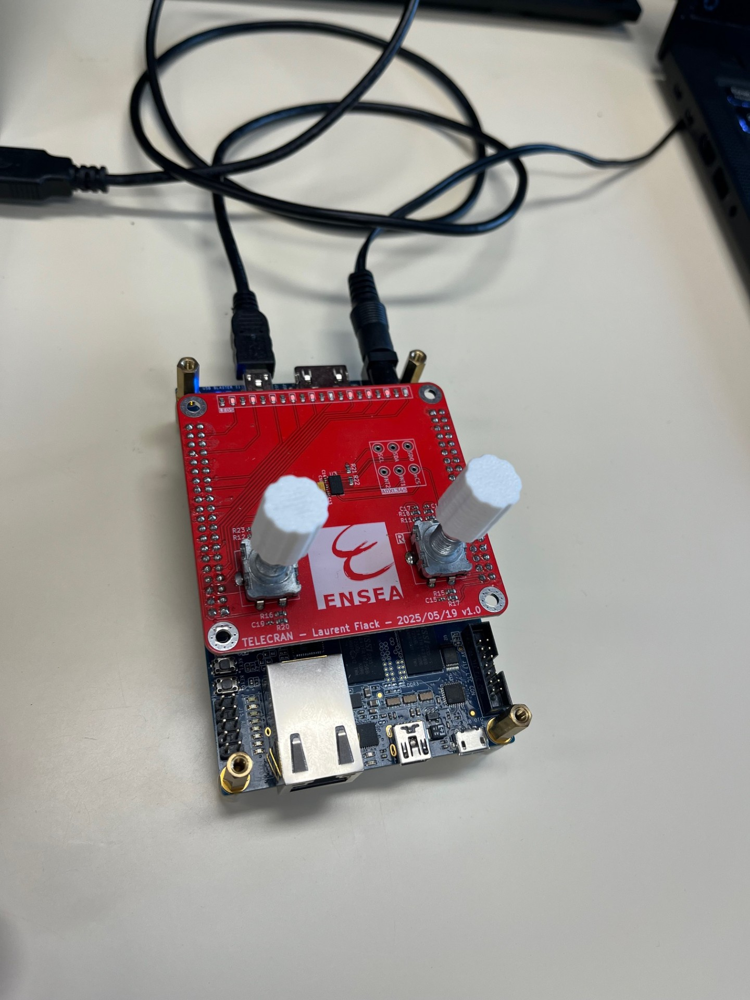 | 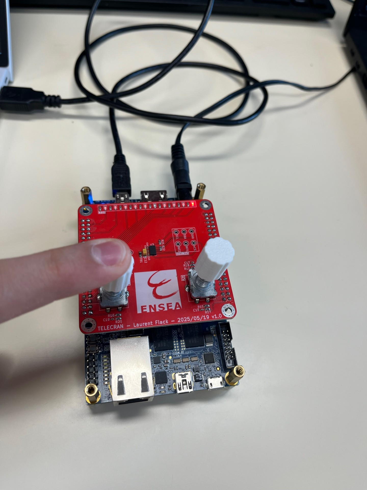 |

### Faire clignoter une LED

**Q1 — Broche de l'horloge `FPGA_CLK1_50` :** elle est sur `PIN_V11` (DE10-Nano User Manual, table 3-5).

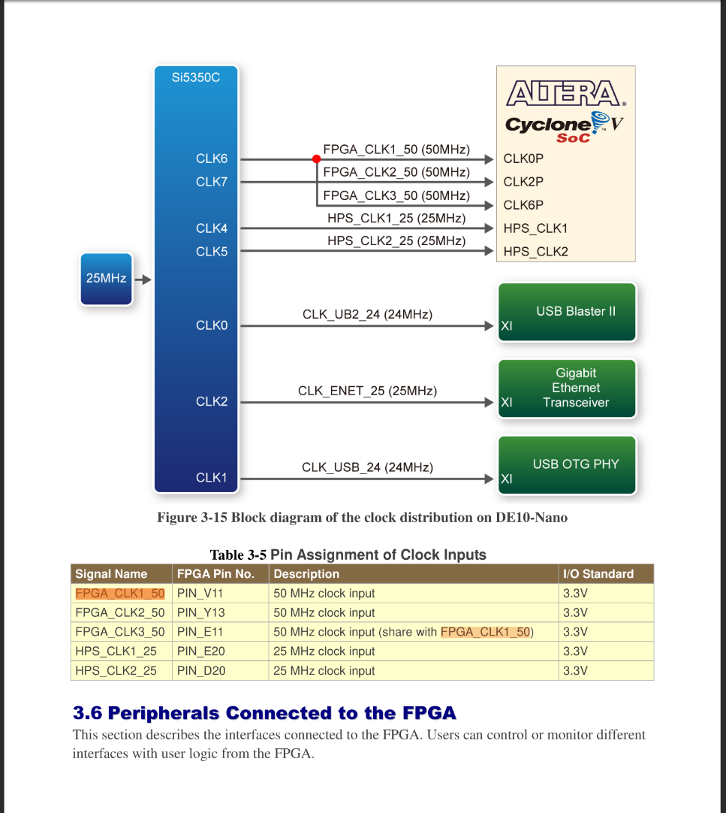

**Q3/Q4 — Schéma du code de base :** une seule bascule D `r_led` dont la sortie est rebouclée sur l'entrée à travers un inverseur. `i_rst_n` est relié à la remise à zéro asynchrone (CLRN). Le RTL Viewer de Quartus donne exactement ce schéma :

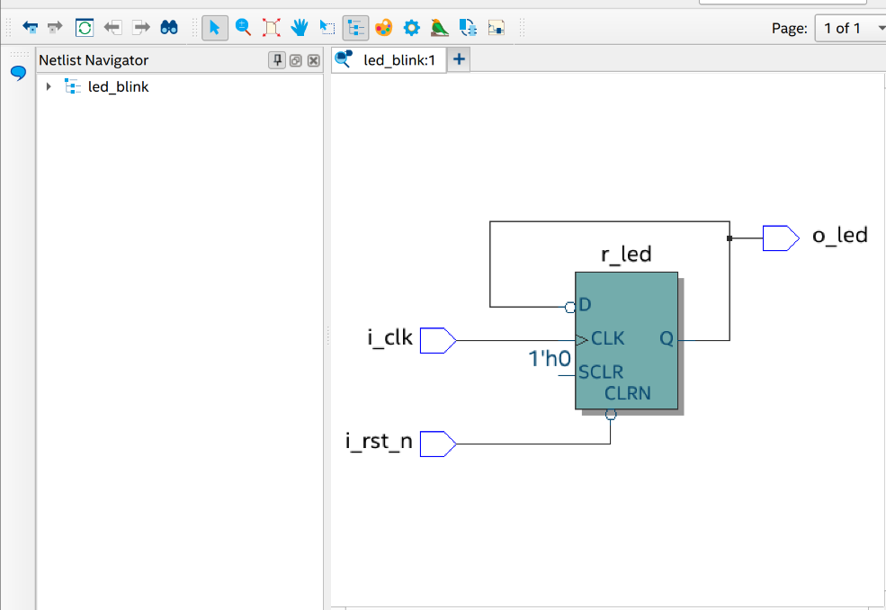

La LED change d'état à chaque front d'horloge, donc elle clignote à 25 MHz : c'est invisible à l'œil.

**Q6/Q7/Q8 — Réduire la fréquence :** code dans [`led_blink.vhd`](3-tp/TP1-Tuto_Quartus/led_blink.vhd). On ajoute :
- un compteur `counter` sur 23 bits (additionneur +1, puis multiplexeur qui le remet à 0) ;
- un comparateur avec 5 000 000 (`23'h4C4B40`) ;
- un registre `r_led_enable`, qui vaut 1 pendant un seul cycle tous les 5 000 001 cycles, soit environ 10 Hz ;
- `r_led` qui n'inverse son état que quand `r_led_enable = '1'` (entrée ENA de la bascule).

La LED change donc d'état 10 fois par seconde : elle clignote à environ 5 Hz. Le RTL Viewer confirme le schéma :


**Q9/Q10 — Reset :** chaque registre a un reset asynchrone sur `i_rst_n`, câblé sur le bouton `KEY0` (`PIN_AH17`).

**Q11 — Que signifie `_n` dans `i_rst_n` ?** Que le signal est actif à l'état bas : le reset agit quand `i_rst_n = '0'`. Ce choix a deux raisons :
- Le matériel : `KEY0` est câblé avec une résistance de pull-up. Il vaut `'1'` au repos et `'0'` quand on appuie, donc l'appui déclenche directement le reset.
- La fiabilité : si le fil est débranché, la pull-up maintient le signal à `'1'` et le circuit n'est pas bloqué en reset. C'est aussi la convention habituelle, qui permet de relier plusieurs sources de reset sur le même fil.

### Chenillard

Code : [`led_blink_chenillard.vhd`](3-tp/TP1-Tuto_Quartus/led_blink_chenillard.vhd)

On réutilise le diviseur de fréquence ci-dessus (impulsion `r_led_enable` à environ 10 Hz). Un registre de 10 bits, initialisé à `"0000000011"`, tourne de 2 positions à chaque impulsion (`r_led(7 downto 0) & r_led(9 downto 8)`). Deux LED allumées défilent donc en boucle sur les 10 LED de la carte mezzanine. Un appui sur `KEY0` ramène le motif au départ.

---

## Séance 2 (19/10/2026) — Projet Écran magique : encodeurs

### Q2 — Détection d'un front montant ou descendant

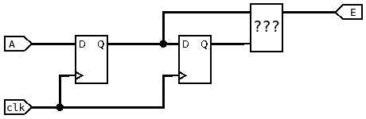

Les deux bascules D en série mémorisent A à deux instants successifs. `A_d1` est la valeur actuelle de A (synchronisée sur `clk`) et `A_d2` sa valeur au coup d'horloge précédent. Si les deux diffèrent, A vient de changer : il y a un front.

| `A_d2` | `A_d1` | Détection |
|:---:|:---:|---|
| 0 | 1 | front montant → `E = A_d1 and not A_d2` |
| 1 | 0 | front descendant → `E = not A_d1 and A_d2` |

Le bloc `???` est donc une simple porte logique. `E` vaut 1 pendant une seule période d'horloge et sert d'*enable* pour incrémenter ou décrémenter le registre. En plaçant la même structure sur la voie B, on distingue les deux sens de rotation en combinant le front d'une voie avec le niveau de l'autre.

La première bascule sert aussi à resynchroniser le signal de l'encodeur, qui arrive de façon asynchrone par rapport à l'horloge du FPGA.

### Q3 — Implémentation

Code : [`encoder.vhd`](3-tp/TP2-Projet_ecran/Encoder/encoder.vhd)

- Un détecteur de fronts, comme ci-dessus, sur chacune des voies A et B (`s_a_rise`, `s_a_fall`, `s_b_rise`, `s_b_fall`).
- La taille du registre est réglable par le generic `g_width` (10 par défaut).
- Incrémentation : front montant sur A avec B à 0, **ou** front descendant sur A avec B à 1.
- Décrémentation : front montant sur B avec A à 0, **ou** front descendant sur B avec A à 1.

Pour le test sur carte, le top [`encoder_leds.vhd`](3-tp/TP2-Projet_ecran/Encoder/encoder_leds.vhd) affiche la valeur sous forme de barre : la LED *i* s'allume si la valeur est strictement supérieure à *i*. Schéma RTL :

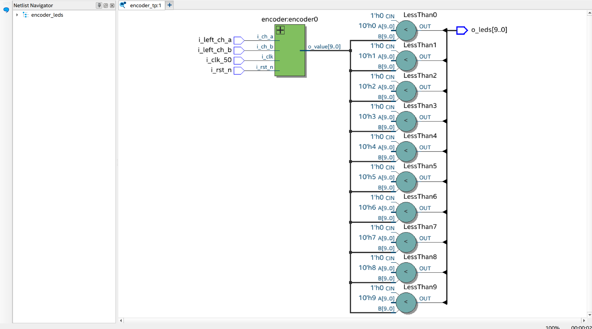

### Q4 — Simulation

Testbench : [`encoder_tb.vhd`](3-tp/TP2-Projet_ecran/Encoder/encoder_tb.vhd). Script : [`encoder.do`](3-tp/TP2-Projet_ecran/Encoder/encoder.do).

Le testbench génère des cycles de quadrature complets dans les deux sens et vérifie la valeur avec des `assert`.

**Rotation à droite (A en avance sur B) :**


**Observations :**
- Chaque front de A produit une impulsion d'un seul cycle (`s_a_rise`, `s_a_fall`), au front d'horloge qui suit le changement de `i_ch_a`, c'est-à-dire dès que `r_a_d1` et `r_a_d2` diffèrent.
- Dans ce sens, seuls les fronts de A remplissent une condition d'incrémentation. La valeur augmente donc de **+2 par cycle de quadrature** : de 0 à 8 en 4 cycles.

**Rotation à gauche (B en avance sur A), puis reset :**


**Observations :**
- La valeur descend de 8 jusqu'à 0, puis passe à **1023 et 1022**. Le registre de 10 bits non signé reboucle bien à `2^10 - 1`.
- Le reset en cours de fonctionnement remet la valeur à 0.
- Aucune assertion n'échoue.

### Q5 — Test sur carte

> 📝 À compléter : résultat du test avec `encoder_leds` (sens de rotation, nombre de LED par cran, rebonds éventuels) et photo de la carte.

### Contrôleur HDMI : préparation

Le contrôleur HDMI du TD 3 ([`hdmi_controler.vhd`](3-tp/telecran/telecran/hdmi_controler.vhd)) a été ajouté au projet `telecran`. Son testbench ([`hdmi_controler_tb.vhd`](3-tp/TP2-Projet_ecran/HDMI/hdmi_controler_tb.vhd)) et son script de simulation ([`hdmi_controler.do`](3-tp/TP2-Projet_ecran/HDMI/hdmi_controler.do)) ont aussi été écrits.

---

## Séance 3 (03/11/2026) — Projet Écran magique : contrôleur HDMI, déplacement d'un pixel et mémorisation

### Partie 1 — Contrôleur HDMI

#### Q1 — Simulation du contrôleur

Simulation dans ModelSim avec `do hdmi_controler.do` (dossier `3-tp/TP2-Projet_ecran/HDMI`). Timings mesurés :

| Grandeur | Mesure | Standard 480p (CEA-861) |
|---|:---:|:---:|
| Période d'une ligne | 858 cycles | 858 |
| Largeur de HS (actif bas) | 62 cycles | 62 |
| Largeur de VS (actif bas) | 6 lignes | 6 |
| Pixels actifs par ligne (DE = 1) | 720 | 720 |
| Lignes actives par image | 480 | 480 |
| Nombre de lignes par image | 525 | 525 |
| Plage de `x` / `y` | 0–719 / 0–479 | — |

À 27 MHz, on obtient 27·10⁶ / (858 × 525) ≈ **60 images/s**.

**Observation :** `o_x_counter` est en avance d'un cycle sur `o_hdmi_de`, qui est registré. Une couleur calculée directement depuis `x` est donc décalée d'un pixel, ce qui ne se voit pas. Ce décalage sera compensé dans la partie Mémorisation par le cycle de latence de la lecture en RAM.

**Chronogrammes au début de la première image** (horloge du testbench : 10 ns, soit une ligne = 8,58 µs) :

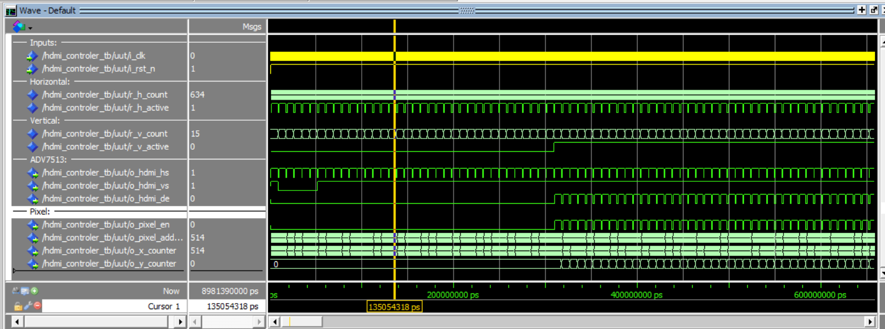

**Observations :**
- Au relâchement du reset, `o_hdmi_vs` passe à 0 pendant environ 50 µs, soit **6 lignes** : c'est l'impulsion de synchro verticale.
- `o_hdmi_hs` et `r_h_active` produisent une impulsion à chaque ligne, tout au long de la simulation.
- Tant que `r_v_active = 0`, il n'y a aucune impulsion sur `o_hdmi_de` ni sur `o_pixel_en`, et `o_y_counter` reste à 0. Ce sont les lignes de blanking vertical (sync + porch).
- `r_v_active` passe à 1 vers **310 µs**, soit 36 lignes × 8,58 µs. C'est le début de la zone visible (`v_start` = 35). À partir de là, DE et `o_pixel_en` pulsent une fois par ligne, et `o_y_counter` s'incrémente à chaque ligne.
- Au curseur (135 µs) : `r_h_count` = 634 donne `o_x_counter` = 634 − 120 = **514**. `r_v_count` = 15 est encore dans le blanking, donc `y` = 0 et `o_pixel_address` = 514 + 0 × 720 = 514. `x` continue de compter pendant le blanking vertical, mais ce n'est pas un problème car `o_pixel_en` = 0.

#### Q2/Q3/Q4 — Intégration dans le top

Dans [`telecran.vhd`](3-tp/telecran/telecran/telecran.vhd) :
- le composant `hdmi_controler` est instancié avec l'horloge à 27 MHz et le reset fournis par la PLL (`s_clk_27`, `s_rst_n` = `locked`) ;
- `o_pixel_en` et `o_pixel_address` ne sont pas utilisés (`open`) ;
- la couleur des pixels dépend des compteurs :

```vhdl
o_hdmi_tx_d(23 downto 16) <= std_logic_vector(to_unsigned(s_x_counter mod 256, 8)); -- rouge = x
o_hdmi_tx_d(15 downto 8)  <= std_logic_vector(to_unsigned(s_y_counter mod 256, 8)); -- vert  = y
o_hdmi_tx_d(7 downto 0)   <= (others => '0');                                       -- bleu  = 0
```

#### Q5 — À quels bits correspond chaque couleur ?

| Bits de `o_hdmi_tx_d` | Composante |
|:---:|:---:|
| 23 – 16 | Rouge |
| 15 – 8 | Vert |
| 7 – 0 | Bleu |

L'image attendue est la suivante :
- en haut à gauche, du noir ;
- le rouge augmente vers la droite et repart de 0 à x = 256 et x = 512 (environ 3 bandes) ;
- le vert augmente vers le bas et repart de 0 à y = 256 (environ 2 bandes) ;
- les zones où rouge et vert se mélangent virent au jaune.

#### Correction de la contrainte d'horloge

Le fichier [`telecran.sdc`](3-tp/telecran/telecran/telecran.sdc) déclarait l'horloge sur `FPGA_CLK1_50`, un port qui n'existe pas dans notre top. Quartus n'avait donc aucune contrainte d'horloge. L'horloge est maintenant déclarée sur `i_clk_50`, et `derive_pll_clocks` contraint aussi l'horloge de 27 MHz.

**Résultat de la compilation :** 0 erreur, 0 warning critique, 99 ALM utilisés (moins de 1 %). Les marges de setup sont positives : 15,0 ns sur `i_clk_50` et 33,3 ns sur l'horloge de la PLL.

#### Q6 — Test sur carte

Le test a été fait sur la carte, avec l'adaptateur HDMI→USB et VLC (capture DirectShow) :

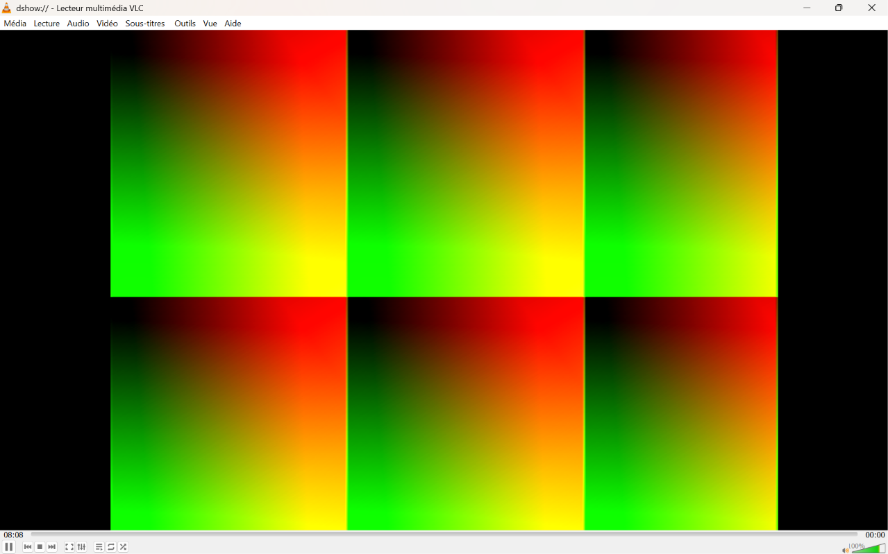

**Observations :**
- L'image est stable, sans scintillement ni défilement : les timings 480p sont bien acceptés par l'ADV7513 et par l'adaptateur.
- Le coin en haut à gauche de chaque pavé est **noir**. Le **rouge** augmente vers la droite (x) et le **vert** vers le bas (y). Les zones où les deux sont forts virent au **jaune**. Il n'y a **pas de bleu**. Les bits sont donc bien attribués : rouge = 23–16, vert = 15–8, bleu = 7–0.
- Horizontalement, il y a **3 pavés** : le rouge repart de 0 à x = 256 et x = 512 à cause du `mod 256`. Le 3e pavé est plus étroit et moins rouge, car il ne couvre que x = 512 à 719, soit 208 valeurs : le rouge s'arrête à 207 au lieu de 255.
- Verticalement, il y a **2 pavés** : le vert repart de 0 à y = 256. Le 2e pavé est moins haut (y = 256 à 479, soit 224 lignes) et son vert va un peu moins loin.
- Les bandes noires à gauche et à droite viennent de VLC, pas du FPGA : VLC affiche le 720×480 au format 4:3 du standard 480p, dont les pixels ne sont pas carrés.
- 📝 À confirmer : un appui sur `KEY0` réinitialise la PLL et le contrôleur, donc l'image doit disparaître puis revenir à l'identique.

### Partie 2 — Déplacement d'un pixel

Objectif : afficher un seul pixel blanc sur fond noir. L'encodeur gauche le déplace horizontalement et l'encodeur droit verticalement. L'énoncé indique « gauche » pour les deux, c'est une coquille.

Code : [`Deplacement_pixel/telecran.vhd`](3-tp/TP2-Projet_ecran/Deplacement_pixel/telecran.vhd), une copie du top de la partie HDMI modifiée pour cette étape. Il utilise [`encoder.vhd`](3-tp/TP2-Projet_ecran/Encoder/encoder.vhd).

#### Principe

Pendant le balayage, le contrôleur HDMI fournit les coordonnées (`s_x_counter`, `s_y_counter`) du pixel en cours d'affichage. Il suffit de les comparer à la position donnée par les encodeurs :
- si `s_x_counter = x_encodeur` **et** `s_y_counter = y_encodeur`, le pixel est **blanc** (`x"FFFFFF"`) ;
- sinon, il est **noir** (`x"000000"`).

#### Q1 — Modifications de `telecran.vhd`

- **Deux instances de `encoder`** : `encoder_x` sur l'encodeur gauche et `encoder_y` sur l'encodeur droit, en 10 bits.
- **Même horloge que le contrôleur HDMI** : les encodeurs tournent sur `s_clk_27` / `s_rst_n` (27 MHz, PLL). Les positions et les compteurs HDMI sont ainsi dans le même domaine d'horloge, sans problème de passage d'un domaine à l'autre au moment de la comparaison.
- **Le pixel reste dans l'écran** : `encoder.vhd` a reçu deux nouveaux generics, `g_saturate` et `g_max`. Ici, x est bloqué entre 0 et 719 et y entre 0 et 479. Sans ça, en tournant à gauche depuis 0, la valeur passait à 1023 et le pixel disparaissait hors de l'écran.
- **Couleur registrée** (`r_pixel`) : la couleur sort un cycle plus tard, donc en phase avec `o_hdmi_tx_de`, qui est lui-même registré dans le contrôleur (voir l'observation de la Q1 de la partie 1). Sans ce registre, le pixel serait décalé d'une colonne, et invisible à x = 0.
- **LED de débogage** : x s'affiche en binaire sur les 10 LED de la mezzanine (`o_leds`), y sur les 8 LED de la DE10-Nano (`o_de10_leds`).

```vhdl
process(s_clk_27, s_rst_n)
begin
	if (s_rst_n = '0') then
		r_pixel <= (others => '0');
	elsif rising_edge(s_clk_27) then
		if (s_x_counter = to_integer(unsigned(s_enc_x))) and (s_y_counter = to_integer(unsigned(s_enc_y))) then
			r_pixel <= x"FFFFFF";
		else
			r_pixel <= x"000000";
		end if;
	end if;
end process;

o_hdmi_tx_d <= r_pixel;
```

#### Schéma RTL généré par Quartus

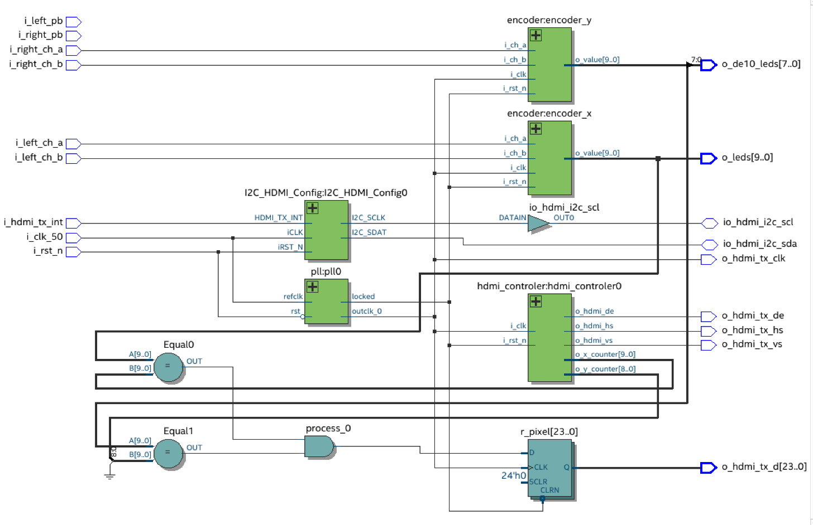

**Lecture du schéma :**
- `encoder_x` (voies `i_left_ch_a/b`) et `encoder_y` (voies `i_right_ch_a/b`) reçoivent tous les deux l'horloge `outclk_0` et le signal `locked` de la PLL.
- Leurs sorties vont vers les LED (`o_leds[9..0]` et `o_de10_leds[7..0]`) et vers deux comparateurs :
  - `Equal0` compare x à `o_x_counter` ;
  - `Equal1` compare y à `o_y_counter`. Ce compteur ne fait que 9 bits, Quartus complète donc le 10e bit par un 0 (symbole de masse).
- La porte ET (`process_0`) combine les deux égalités. Sa sortie entre dans le registre `r_pixel[23..0]` (24 bits identiques, donc blanc ou noir), qui pilote `o_hdmi_tx_d`. Le reset asynchrone (CLRN) de ce registre vient de `locked`.
- `i_left_pb` et `i_right_pb` (boutons des encodeurs) ne sont reliés à rien pour l'instant. L'un d'eux servira à l'effacement.

#### Premier test sur carte : déplacement erratique

Le premier essai affichait bien le pixel, mais son déplacement était **erratique** : il sautait de plusieurs positions et revenait parfois en arrière. L'enseignant a identifié la cause : les **rebonds** des contacts mécaniques des encodeurs.

**Explication :** à chaque cran, A et B oscillent plusieurs fois avant de se stabiliser. À 27 MHz, chaque oscillation est vue comme un vrai front. Avec la règle de comptage de l'énoncé, ces rebonds ne s'annulent pas. Par exemple, pour un rebond sur A pendant une rotation à droite (B = 0) :
- front montant de A : +1 ;
- front descendant de A : aucune règle ne s'applique (ni incrément ni décrément) ;
- front montant suivant : encore +1.

Chaque rebond ajoute donc un pas en trop.

#### Correction : filtre anti-rebond

Deux étages ont été ajoutés dans [`encoder.vhd`](3-tp/TP2-Projet_ecran/Encoder/encoder.vhd), avant le détecteur de fronts :
1. **Un synchroniseur à 2 bascules** (`r_a_meta` → `r_a_sync`) : A et B sont asynchrones par rapport à l'horloge, ce qui évite la métastabilité. Avant, une seule bascule faisait ce travail.
2. **Un filtre de stabilité** :
   - un compteur (`r_a_cnt`) s'incrémente tant que l'entrée synchronisée diffère de la valeur filtrée (`r_a_d1`) ;
   - **chaque rebond le remet à 0** ;
   - la valeur filtrée ne change que si l'entrée est restée stable pendant `g_debounce` cycles.

Le détecteur de fronts travaille ensuite sur la valeur filtrée. Dans le top, `g_debounce = 27_000`, soit **1 ms à 27 MHz** : c'est plus long qu'un rebond, mais bien plus court que le temps entre deux crans, même en tournant vite. Par défaut, `g_debounce = 0` (pas de filtre), donc le testbench d'origine de la séance 2 passe toujours.

**Simulation** : [`encoder_rebonds_tb.vhd`](3-tp/TP2-Projet_ecran/Encoder/encoder_rebonds_tb.vhd), à lancer avec `do encoder_rebonds.do`. Les mêmes signaux A/B, avec 3 rebonds sur A et 1 sur B à chaque front (120 ns chacun), sont envoyés à un encodeur sans filtre et à un encodeur avec filtre (`g_debounce` = 50 cycles = 1 µs) :

| Après… | Attendu | Sans filtre | Avec filtre |
|---|:---:|:---:|:---:|
| 1 cycle à droite | 2 | 6 | 2 ✅ |
| 2 cycles à droite | 4 | 12 | 4 ✅ |
| 4 cycles à droite | 8 | **24** | 8 ✅ |
| puis 4 cycles à gauche | 0 | 0 | 0 ✅ |

Sans filtre, le compteur va **3 fois trop loin**. Avec le filtre, la valeur est exacte à chaque cycle.

**Compilation** : 0 erreur, 171 ALM (moins de 1 %). Les marges de setup sont positives : 15,0 ns sur `i_clk_50` et 28,3 ns sur l'horloge à 27 MHz.

#### Q2 — Test sur carte après correction

▶️ [Vidéo du test de déplacement du pixel](3-tp/TP2-Projet_ecran/Deplacement_pixel/img/test_deplacement_pixel.mp4) (GitHub ne lit pas la vidéo dans la page : cliquer sur le lien puis sur *View raw* pour la télécharger)

> 📝 Observations de la vidéo (le point avance régulièrement à chaque cran, sens horizontal/vertical corrects, blocage aux bords, retour au point de départ après N crans aller-retour, effet de KEY0).

#### Q3 — Démonstration à l'enseignant

L'enseignant a vu le premier essai : c'est lui qui a repéré le problème des rebonds.

> 📝 À confirmer : validation de la version avec anti-rebond.

### Partie 3 — Mémorisation

Objectif : garder affichés les pixels déjà parcourus par le stylet, comme sur un vrai écran magique. On utilise pour ça une mémoire d'image (*framebuffer*).

Code : [`Memorisation/telecran.vhd`](3-tp/TP2-Projet_ecran/Memorisation/telecran.vhd), une copie du top de la partie 2, avec les encodeurs, l'anti-rebond et le blocage dans l'écran. La mémoire est [`dpram.vhd`](3-tp/telecran/telecran/dpram.vhd), fournie.

#### Q1 — Qu'est-ce qu'une mémoire *dual-port* ?

Une mémoire **dual-port** (double port) possède **deux ports d'accès indépendants**, A et B. Chacun a sa propre horloge, son adresse, son entrée de données, son signal d'écriture (`we`) et sa sortie de données. Les deux ports accèdent **en même temps** au même tableau mémoire : on peut écrire par un port pendant qu'on lit par l'autre, sans que l'un attende l'autre.

Ici, c'est exactement ce qu'il faut :
- le **port A** sert au stylet, qui écrit à la position des encodeurs ;
- le **port B** sert au contrôleur HDMI, qui lit l'image en continu, 60 fois par seconde.

Avec une mémoire simple port, il faudrait partager un seul port entre les deux, et l'affichage serait perturbé à chaque écriture.

Dans `dpram.vhd`, la lecture est **synchrone** : la donnée sort sur `o_q_a` / `o_q_b` **un cycle d'horloge après** que l'adresse a été présentée.

#### Q2 — Schéma

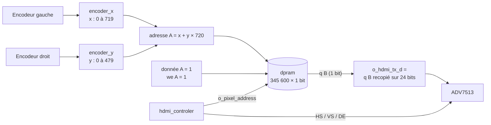

- **1 bit par pixel** : un pixel est soit dessiné (1, blanc), soit vide (0, noir). Il faut 720 × 480 = 345 600 bits, qui tiennent dans 43 blocs mémoire M10K, soit 8 % du FPGA. En 24 bits par pixel, il faudrait 8,3 Mbits : plus que tout le FPGA (5,6 Mbits).
- **Port A** : il écrit un `1` en permanence à l'adresse du stylet. Quand le stylet se déplace, l'ancienne case garde son `1` : c'est ce qui laisse la trace.
- **Port B** : en lecture seule (`we_b = '0'`), à l'adresse `o_pixel_address` du contrôleur HDMI.
- **Même formule d'adresse** des deux côtés (`x + y × 720`, celle du contrôleur). Sinon, on n'écrirait pas sur le pixel qu'on lit.
- **Même horloge** (27 MHz) sur les deux ports, pour rester dans un seul domaine d'horloge.

#### Q3 — Instanciation de `dpram`

```vhdl
-- Adresse d'ecriture : meme convention que le controleur HDMI
s_wr_addr <= to_integer(unsigned(s_enc_x)) + to_integer(unsigned(s_enc_y)) * h_res;

framebuffer : entity work.dpram
	generic map (
		mem_size => h_res * v_res,
		data_width => 1
	)
	port map (
		i_clk_a => s_clk_27,
		i_addr_a => s_wr_addr,
		i_data_a => "1",
		i_we_a => '1',
		o_q_a => open,

		i_clk_b => s_clk_27,
		i_addr_b => s_rd_addr,      -- = o_pixel_address du controleur
		i_data_b => "0",
		i_we_b => '0',
		o_q_b => s_rd_data
	);
```

La sortie `o_pixel_address` du contrôleur HDMI, laissée à `open` jusqu'ici, est maintenant reliée à `s_rd_addr`. Les sorties `o_x_counter` / `o_y_counter` ne servent plus : la comparaison de la partie 2 est remplacée par la lecture en mémoire.

#### Q4 — Nouveau signal `o_hdmi_tx_d`

```vhdl
o_hdmi_tx_d <= (others => s_rd_data(0));   -- blanc si le pixel a ete dessine, noir sinon
```

Le registre `r_pixel` de la partie 2 n'est plus nécessaire. La lecture en RAM ajoute déjà un cycle de retard, ce qui cale la donnée exactement sur `o_hdmi_tx_de`, lui aussi en retard d'un cycle dans le contrôleur. C'est le décalage repéré lors de la simulation HDMI (partie 1, Q1), qui se compense ici tout seul.

**Simulation de l'alignement** : [`memorisation_tb.vhd`](3-tp/TP2-Projet_ecran/Memorisation/memorisation_tb.vhd), à lancer avec `do memorisation.do`.
- Le testbench associe le vrai `hdmi_controler` et la vraie `dpram`, en résolution réduite (16 × 8) pour aller vite.
- Il écrit 3 pixels, dont deux dans les coins (x = 0 et x = 15), puis reconstruit l'image vue par l'écran (les pixels où DE = 1).

| Vérification | Attendu | Obtenu |
|---|:---:|:---:|
| Pixels affichés par image | 128 | 128 ✅ |
| Pixels blancs | 3 | 3 ✅ |
| Pixels à la mauvaise position | 0 | 0 ✅ |

Pour s'assurer que ce test détecte vraiment un décalage, on l'a relancé en attendant volontairement les pixels une colonne plus loin : il signale alors 5 erreurs. Le résultat positif est donc fiable.

**Compilation** :
- 0 erreur ;
- 230 ALM et **345 600 bits de mémoire dans 43 blocs M10K** : Quartus a bien placé la `dpram` dans les blocs mémoire (`altsyncram`) et ne l'a pas construite avec des bascules ;
- marges de setup positives : 14,6 ns sur `i_clk_50` et 23,3 ns sur l'horloge à 27 MHz.

**Chronogrammes de `memorisation.do`** (zoom sur une période de blanking vertical) :

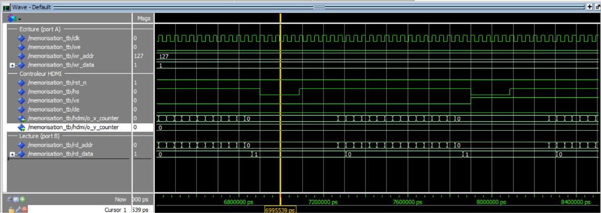

**Observations :**
- La phase d'écriture est terminée : `we = 0`, et la dernière adresse écrite est `wr_addr = 127`, soit le pixel (15, 7) en bas à droite.
- On est pendant le **blanking vertical** : `vs` est bas, `de` reste à 0 et `o_y_counter` vaut 0. Pendant ce temps, le contrôleur continue de balayer x, donc `rd_addr` aussi, mais aucun pixel n'est envoyé à l'écran.
- **La latence de la RAM est visible** : quand `rd_addr` passe à 0, `rd_data` passe à `1` **un cycle d'horloge plus tard**. Le pixel (0, 0) a bien été dessiné, et sa valeur sort avec un cycle de retard. C'est ce cycle qui remplace le registre `r_pixel` de la partie 2.
- Quand `rd_addr` quitte 0, `rd_data` revient à `0`, un cycle plus tard lui aussi : les autres pixels de la ligne n'ont pas été dessinés.

#### Q5 — Test sur carte

Comportement attendu :
- au démarrage, un point blanc en (0, 0) sur fond noir (la RAM démarre à 0 à la programmation) ;
- l'encodeur gauche trace une ligne horizontale et l'encodeur droit une ligne verticale ;
- le dessin reste affiché ;
- `KEY0` ramène le stylet en (0, 0) mais **n'efface pas** le dessin, car la RAM n'a pas de reset (voir l'effacement).

> 📝 À compléter : capture VLC d'un dessin et observations.

#### Q6 — Démonstration à l'enseignant

> 📝 À compléter.

---

## Séance 4 — Projet Écran magique : effacement

### Q1 — Comment effacer l'écran ?

*Méthode prévue, à valider à l'implémentation.*

**Pourquoi c'est plus compliqué qu'il n'y paraît :** une RAM n'a pas de reset global. Chaque port ne peut écrire **qu'une seule adresse par cycle d'horloge**. Pour effacer l'écran, il faut donc écrire un `0` dans chacune des 345 600 cases, l'une après l'autre.

**Solution :** une petite **machine d'état** prend le contrôle du port A pendant l'effacement :

| État | Adresse du port A | Donnée du port A | Passage à l'état suivant |
|---|---|---|---|
| `DESSIN` | position du stylet (`x + y × 720`) | `1` | appui sur le bouton → `EFFACEMENT` |
| `EFFACEMENT` | compteur `r_clr_addr`, de 0 à 345 599 (+1 par cycle) | `0` | `r_clr_addr = 345 599` → `DESSIN` |

- **Bouton** : celui de l'encodeur gauche (`i_left_pb`, `PIN_AH27`). Il est actif bas : `'1'` au repos, `'0'` quand on appuie (comme `pushl` au TP1). Il passe par le même synchroniseur et le même anti-rebond que les voies des encodeurs, puis par une détection de front, pour ne lancer qu'**un** effacement par appui.
- **Multiplexeur** sur l'adresse et la donnée du port A, commandé par l'état.
- **Durée** : 345 600 cycles à 27 MHz ≈ **12,8 ms**. C'est moins qu'une image (16,7 ms), donc l'effacement est quasi instantané à l'œil.
- **Le port B continue de lire** pendant l'effacement : l'affichage n'est pas interrompu, il n'y a pas de conflit.

### Q2 — Implémentation

> 📝 À faire.

### Q3 — Démonstration à l'enseignant

> 📝 À faire.

---

## Suivi des questions de l'énoncé

✅ répondu · 📝 à compléter (test, capture ou démonstration) · ⏳ pas encore traité

| Partie | Question de l'énoncé | État | Où |
|---|---|:---:|---|
| **TP1** | Programmation : « Ça fonctionne ? » / comportement inversé | ✅ | [Premier projet](#premier-projet--un-bouton-allume-une-led) |
| | Q1 Broche de `FPGA_CLK1_50` | ✅ | [Faire clignoter une LED](#faire-clignoter-une-led) |
| | Q3/Q4 Schéma du code + comparaison avec le RTL Viewer | ✅ | idem |
| | Q6/Q7/Q8 Réduction de fréquence, schéma, vérification RTL | ✅ | idem |
| | Q9/Q10 Reset sur chaque registre, `KEY0` | ✅ | idem |
| | Q11 Signification de `_n` | ✅ | idem |
| | Chenillard (code + démonstration) | ✅ | [Chenillard](#chenillard) |
| **Encodeurs** | Q2 Détection d'un front | ✅ | [Séance 2](#q2--détection-dun-front-montant-ou-descendant) |
| | Q3 Implémentation | ✅ | [Q3](#q3--implémentation) |
| | Q4 Simulation | ✅ | [Q4](#q4--simulation) |
| | Q5/Q6 Test sur carte, démonstration | 📝 | [Q5](#q5--test-sur-carte) |
| **HDMI** | Visualisation de la sortie HDMI (VLC) | ✅ | [Partie 1, Q6](#q6--test-sur-carte) |
| | Q1 Simulation du contrôleur | ✅ | [Partie 1, Q1](#q1--simulation-du-contrôleur) |
| | Q2/Q3/Q4 Ajout, instanciation, connexion des compteurs | ✅ | [Partie 1, Q2/Q3/Q4](#q2q3q4--intégration-dans-le-top) |
| | Q5 Bits de chaque couleur | ✅ | [Partie 1, Q5](#q5--à-quels-bits-correspond-chaque-couleur-) |
| | Q6 Compilation et test | ✅ (📝 effet de KEY0) | [Partie 1, Q6](#q6--test-sur-carte) |
| | Q7 Démonstration à l'enseignant | 📝 | — |
| **Déplacement d'un pixel** | Q1 Modification de `telecran.vhd` | ✅ | [Partie 2](#partie-2--déplacement-dun-pixel) |
| | Q2 Test sur carte | ✅ (📝 observations de la vidéo) | [Partie 2, Q2](#q2--test-sur-carte-après-correction) |
| | Q3 Démonstration à l'enseignant | 📝 | [Partie 2, Q3](#q3--démonstration-à-lenseignant) |
| **Mémorisation** | Q1 Mémoire dual-port | ✅ | [Partie 3, Q1](#q1--quest-ce-quune-mémoire-dual-port-) |
| | Q2 Schéma | ✅ | [Partie 3, Q2](#q2--schéma) |
| | Q3 Instanciation de `dpram` | ✅ | [Partie 3, Q3](#q3--instanciation-de-dpram) |
| | Q4 Modification de `o_hdmi_tx_d` | ✅ | [Partie 3, Q4](#q4--nouveau-signal-o_hdmi_tx_d) |
| | Q5 Test sur carte | 📝 | [Partie 3, Q5](#q5--test-sur-carte-1) |
| | Q6 Démonstration à l'enseignant | 📝 | — |
| **Effacement** | Q1 Méthode | ✅ (méthode prévue) | [Séance 4, Q1](#q1--comment-effacer-lécran-) |
| | Q2 Implémentation | ⏳ | — |
| | Q3 Démonstration à l'enseignant | ⏳ | — |

---

## Annexe : simuler et tester

**Simulation (ModelSim) :** se placer dans le dossier du composant et lancer le script `.do` :
```
cd 3-tp/TP2-Projet_ecran/Encoder   ->  do encoder.do
cd 3-tp/TP2-Projet_ecran/Encoder   ->  do encoder_rebonds.do   (anti-rebond)
cd 3-tp/TP2-Projet_ecran/HDMI      ->  do hdmi_controler.do
cd 3-tp/TP2-Projet_ecran/Memorisation  ->  do memorisation.do
```

**Test sur carte (Quartus) :**
1. Ouvrir `3-tp/telecran/telecran/telecran.qpf`, puis lancer *Compile Design*.
2. Brancher l'alimentation, le port USB BLASTER II, et le câble HDMI vers l'adaptateur HDMI-USB.
3. *Tools > Programmer* > *Auto Detect* > choisir `5CSEBA6` > *Change File* : `output_files/telecran.sof` > cocher *Program/Configure* > *Start*.
4. Dans VLC : *Media > Open Capture Device* > DirectShow > choisir l'adaptateur.
5. Si VLC affiche « pas de signal », appuyer sur `KEY0`. Le reset relance la configuration I2C de l'ADV7513.
